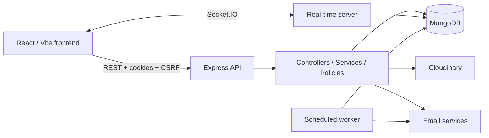

<div align="center">
OpSync — Backend
Secure REST APIs, real-time collaboration, and workflow automation for a unified team operations platform.


Frontend Repository · Development Branch · API Documentation
</div>
---
Overview
OpSync is a full-stack team operations platform that brings projects, tasks, teams, conversations, file sharing, automation rules, and reporting into a single workspace. This repository contains the Express REST API, Socket.IO server, MongoDB persistence layer, and scheduled automation worker.
> **Release status:** This README documents the `v2-development` branch. The V2 security and integration audit is in progress; do not treat this branch as a verified production release.
Features
Account and session management: signup, login, access/refresh cookies, logout, password recovery, email verification, profile settings, data export, and account lifecycle endpoints.
Team and project operations: teams, memberships, projects, task assignments, progress tracking, and role-aware access.
Real-time messaging: authenticated conversation rooms, messages, typing indicators, read state, and online presence.
File management: project-based uploads, listing, download links, and deletion, with Cloudinary integration.
Automation: configurable rules and a separate worker for scheduled overdue-task checks.
Analytics and activity: dashboards, reporting, and user activity records.
API operations: structured error responses, health checks, OpenAPI endpoint, and graceful shutdown.
🧰 Tech Stack
The badges use the rectangular, high-contrast style shown in the reference image.
Core runtime and API


Data, storage, and services


Security, delivery, and tooling


System Architecture

Repository layout
```text
server.js             API, middleware, routes, Socket.IO, startup and shutdown
worker.js             Scheduled automation worker
routes/               REST endpoint definitions
controllers/          HTTP request handlers
services/             Domain, activity, automation, and email operations
policies/             Authorization decisions
models/               Mongoose schemas
socket/               Socket authentication, rooms, messages, and presence
middlewares/          Authentication, CSRF, validation, and error handling
config/               Database, cookies, and external integrations
docs/openapi.js       OpenAPI document
scripts/              Database maintenance and seed utilities
```
Getting Started
Prerequisites
Node.js 22+ and npm
MongoDB (use a replica set for transaction-backed operations)
Cloudinary credentials for file-related features
SMTP/email credentials for password reset, verification, and notification workflows
Installation
```powershell
git clone https://github.com/shreyapatil05/opsync-backend.git
cd opsync-backend
git switch v2-development
Copy-Item .env.example .env
npm ci
npm run dev
```
Edit `.env` before starting. If `.env.example` is absent in your checkout, create `.env` manually using the configuration table below.
By default, the API runs at http://localhost:5000. Check readiness at http://localhost:5000/health/ready.
To start the automation worker in a separate terminal:
```powershell
npm run dev:worker
```
> Run only one worker per schedule unless you implement a distributed lock or external scheduler. Each worker replica otherwise runs the cron job independently.
Environment Configuration
Variable	Requirement	Default / purpose
`MONGO_URI`	Required	MongoDB connection URI
`MONGO_MAX_POOL_SIZE`	Optional	`10`
`PORT`	Optional	`5000`
`NODE_ENV`	Optional	`development`
`FRONTEND_URL`	Required for browser/email flows	Exact allowed frontend origin and email-link base
`COOKIE_SECURE`	Production HTTPS	`false`; set `true` for `Secure`, `SameSite=None` cookies
`JWT_ACCESS_SECRET`	Required	Access-token signing secret
`JWT_REFRESH_SECRET`	Required	Separate refresh-token signing secret
`ACCESS_TOKEN_EXPIRES`	Optional	`15m`
`REFRESH_TOKEN_EXPIRES`	Optional	`7d`
`CLOUDINARY_CLOUD_NAME`	File features	Cloudinary cloud name
`CLOUDINARY_API_KEY`	File features	Server-side API key
`CLOUDINARY_API_SECRET`	File features	Server-side API secret
`SMTP_HOST`	Account emails	SMTP server
`SMTP_PORT`	Optional	`587`
`SMTP_SECURE`	Optional	Transport TLS setting; inferred for port 465
`SMTP_USER`, `SMTP_PASS`	Account emails	SMTP credentials
`EMAIL_FROM`	Account emails	Sender address
`EMAIL_USER`, `EMAIL_PASS`	Automation emails	Notification mail credentials
`AUTOMATION_CRON`	Optional	`0 9 * * *`
`AUTOMATION_RUN_ON_START`	Optional	`false`
`ADMIN_SEED_*`	Admin seed only	Seed account settings
`DEMO_SEED_PASSWORD`	Demo seed only	Demo password, minimum 12 characters
Never commit `.env`, JWT secrets, SMTP credentials, Cloudinary secrets, or production data.
API Reference
API documentation is available when the server is running:
Swagger UI: `GET /api/docs`
OpenAPI JSON: `GET /api/openapi.json`
Liveness: `GET /health/live`
Readiness: `GET /health/ready`
Route prefix	Purpose
`/api/auth`	Authentication, profile, recovery, verification, and account lifecycle
`/api/users`	User discovery and administration
`/api/teams`	Teams and membership
`/api/projects`	Projects, tasks, assignments, and progress
`/api/chat`	Conversations, search, and chat uploads
`/api/chat/messages`	Message actions and read state
`/api/files`	Project files
`/api/rules`	Automation rules
`/api/analytics`	Analytics
`/api/dashboard`	Operational dashboard
`/api/activities`	Personal activity feed
The OpenAPI document describes a subset of endpoints; the `routes/` directory remains authoritative for the complete API surface.
Real-Time Messaging
Socket.IO uses the HTTP `accessToken` cookie to authenticate the connection.
Client event	Behavior
`join_conversation`	Check conversation access, join room, and mark received messages as read
`leave_conversation`	Leave a room
`send_message`	Send a text message or HTTPS attachment to an authorized joined room
`typing_start`, `typing_stop`	Emit typing activity in a joined room
Server events include `new_message`, `user_typing`, `user_stop_typing`, `user_online`, `user_offline`, `conversation_error`, and `message_error`.
Presence is currently stored in process memory. Multi-instance deployment needs an appropriate shared Socket.IO adapter/presence strategy and load-balancer configuration.
Security and Authorization
The application includes HTTP-only access/refresh cookies, CSRF protection for state-changing HTTP requests, validation, rate limiting, Helmet, and authorization checks. These controls are implemented but require end-to-end verification before production release.
Public registration creates `Employee` accounts only.
Global `Admin` privileges protect administrative workflows.
Project access considers creators, managers, assigned members, and associated team membership.
Project management and task modifications are governed by role/resource policies.
Conversation membership is checked before joining and sending messages.
File downloads require project access; deletion is limited by project-management rights or uploader ownership.
Audit items still open: Socket.IO inactive-account checks, profile response serialization, error disclosure, logging hygiene, file validation depth, and deployment-specific cookie/CORS settings.
Testing and Maintenance
```powershell
npm test
npm run db:sync-indexes
```
The test suite includes policy, CSRF, file-signature, account-serialization, and automation-evaluation coverage. Review database index changes before running the synchronization script on important data.
For controlled seeding only:
```powershell
npm run seed:admin
npm run seed:demo
```
Do not run demo seeding against production data.
Deployment Notes
Run `server.js` and `worker.js` as separate processes.
Use HTTPS and configure `FRONTEND_URL`, cookie flags, and CORS together.
Terminate TLS and support WebSocket upgrades at the reverse proxy.
Keep MongoDB and the worker inaccessible from the public internet.
Use MongoDB backups and define a matching Cloudinary recovery strategy.
Monitor liveness/readiness, failed operations, and structured logs.
Review Docker health-check behavior when MongoDB is temporarily unavailable.
Related Repository
Frontend: https://github.com/shreyapatil05/opsync-frontend
---
<div align="center">
OpSync V2 · Development documentation
</div>